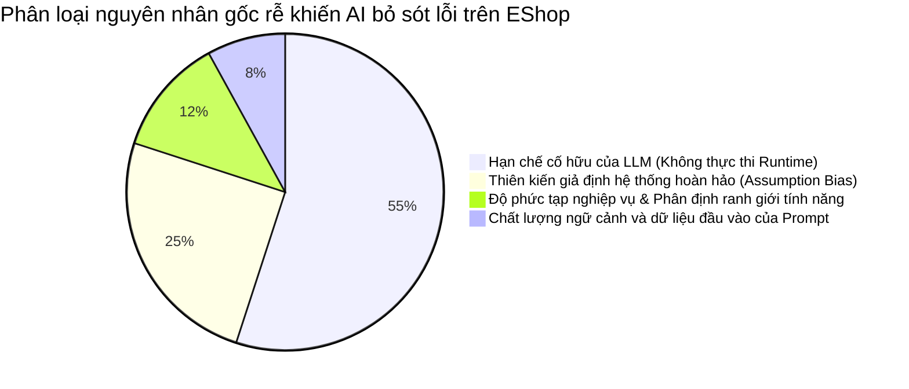

# BÁO CÁO PHÂN TÍCH KHOẢNG TRỐNG AI & PHÊ BÌNH AI HỢP NHẤT
## CONSOLIDATED AI GAP ANALYSIS & AI CRITIQUE REPORT
### MÃ BÀI TẬP: HW02-AI — DOMAIN TESTING & BOUNDARY VALUE ANALYSIS ON ESHOP

* **Môn học:** Kiểm thử phần mềm (Software Testing) — FIT@HCMUS (2026)
* **Mã sinh viên:** 23120127
* **Họ và tên:** Dương Trọng Hòa
* **Hệ thống được kiểm thử (SUT):** EShop Platform (Frontend Web React, Frontend Mobile Expo React Native, Backend Express Node.js, SQLite `database.sqlite`)
* **Các tính năng kiểm thử:**
  * **Pool A:** FR-04 — Quản lý hồ sơ cá nhân (Personal profile management)
  * **Pool B:** FR-08 — Thanh toán (Checkout)
  * **Pool C:** FR-17 — Quản lý mã giảm giá (Coupon CRUD)
  * **Pool D:** FR-05 — Xem danh sách & Tìm kiếm sản phẩm (Mobile App)
* **Công cụ AI áp dụng:** Gemini Argon (Google DeepMind)
* **Cấp độ Bloom-AI yêu cầu:** G9.2 (Apply) và G9.3 (Analyse)
* **Ngày lập báo cáo:** 2026-10-18

---

# PHẦN 1: PHÂN TÍCH KHOẢNG TRỐNG AI HỢP NHẤT (CONSOLIDATED AI GAP ANALYSIS)

> **Căn cứ yêu cầu đề bài (Mục 6.3):**  
> *"Nếu các công cụ AI bỏ sót bất kỳ test case hoặc lỗi nào, bạn phải báo cáo chúng. Giải thích tại sao AI lại bỏ sót — ví dụ: do chất lượng đầu vào của bạn (prompt), do các giới hạn của chính công cụ AI, hay do độ phức tạp vốn có của tính năng được kiểm thử."*

---

### 1.1 Bảng ma trận tổng hợp các lỗi và khoảng trống AI trên 4 tính năng

Dưới đây là bảng đối chiếu chi tiết toàn bộ các lỗ hổng, lỗi nghiệp vụ và tình huống thực tế mà AI đã bỏ sót hoặc suy đoán sai lệch trong quá trình sinh ca kiểm thử trên cả 4 phân hệ:

| STT | Phân hệ (Pool) / Tính năng | Lỗi / Vấn đề thực tế AI bỏ sót hoặc ngộ nhận | Biểu hiện thực tế trên SUT runtime | Phân loại nguyên nhân gốc rễ (Root Cause) | Chi tiết lý do AI bỏ sót |
| :---: | :--- | :--- | :--- | :---: | :--- |
| **1** | **Pool A** (FR-04 Hồ sơ) | **Mâu thuẫn logic trong regex SĐT** (`BUG-FR04-01`) | Hệ thống từ chối SĐT 10 và 11 số hợp lệ của VN, báo lỗi bắt nhập "9-10 chữ số". | **Hạn chế cố hữu của LLM** *(Không thực thi runtime)* | AI chỉ phân tích văn bản đặc tả lý thuyết, không thể tự chạy code thực tế để biết lập trình viên SUT đã viết ngược biểu thức chính quy (regex) trên giao diện. |
| **2** | **Pool A** (FR-04 Hồ sơ) | **Bỏ quên validation Địa chỉ rỗng** (`BUG-FR04-02`) | Form và API cho phép lưu địa chỉ giao hàng rỗng `""` thành công vào SQLite. | **Thiên kiến giả định hoàn hảo** *(Assumption Bias)* | AI có định kiến rằng hệ thống luôn có tầng Data Validation cơ bản cho các trường bắt buộc (`*`), nên không cảnh báo tester về sự thiếu vắng hoàn toàn của logic kiểm tra ở server. |
| **3** | **Pool A** (FR-04 Hồ sơ) | **Không chặn độ dài 255 ký tự** (`BUG-FR04-03`) | Form và API cho phép nhập và lưu chuỗi 256 ký tự (vượt biên $Max+1$) vào CSDL. | **Hạn chế trong việc đọc DOM** *(Hạn chế của AI)* | AI chỉ tính toán được mốc biên lý thuyết $Max+1=256$, nhưng không thể đọc cây DOM/CSS để phát hiện thẻ `<input>` trên giao diện thiếu thuộc tính `maxlength="255"`. |
| **4** | **Pool A** (FR-04 Hồ sơ) | **Lệch URL API thực tế** (`/api/profile` vs `/api/users/me`) | Gọi `PUT /api/profile` bị lỗi HTTP 404 Cannot PUT. | **Chất lượng ngữ cảnh trong Prompt** *(Prompt Quality)* | Prompt ban đầu của sinh viên chỉ đưa đặc tả tổng quan, chưa đính kèm file `backend/server.js`, khiến AI suy đoán endpoint RESTful theo quy ước thông thường. |
| **5** | **Pool B** (FR-08 Checkout) | **Lẫn lộn ranh giới nghiệp vụ giữa FR-08 và FR-09** | AI tự ý đưa các ca kiểm thử mã giảm giá (Coupon C1–C5) vào phạm vi tính năng Checkout. | **Độ phức tạp & Ranh giới tính năng** *(Feature Complexity)* | AI thấy trên trang Checkout có ô nhập mã giảm giá nên gộp chung cả nghiệp vụ FR-09 vào, đòi hỏi tester phải can thiệp bóc tách để đảm bảo đúng phân phối đề bài. |
| **6** | **Pool B** (FR-08 Checkout) | **Ô nhập tổng tiền lộ thiên trên UI** (`BUG-FR08-01`) | Giao diện Checkout đặt sẵn thẻ `<input type="number">` cho phép người dùng tự gõ số tiền tùy ý. | **Thiên kiến giả định hoàn hảo** *(Assumption Bias)* | AI mặc định các nhà phát triển luôn hiển thị tổng tiền ở dạng văn bản chỉ đọc (Read-only / Text), không ngờ lập trình viên lại để mở toang ô nhập liệu. |
| **7** | **Pool B** (FR-08 Checkout) | **Quên xóa giỏ hàng sau checkout** (`BUG-FR08-02`) | Đặt hàng thành công nhưng 2 sản phẩm cũ vẫn còn nguyên trong giỏ hàng. | **Hạn chế cố hữu của LLM** *(Không kiểm tra state transition)* | AI chỉ đọc quy định "giỏ hàng được xóa" nhưng không thể quan sát chuyển trạng thái động của biến trạng thái `userCarts` và component React lúc runtime. |
| **8** | **Pool B** (FR-08 Checkout) | **Giao diện thiếu ô Địa chỉ giao hàng** (`BUG-FR08-03`) | Form đặt hàng không hề có ô nhập địa chỉ, cũng không kế thừa địa chỉ người dùng. | **Mô hình hóa lý thuyết** *(Hạn chế của AI)* | AI suy diễn form đặt hàng chuẩn luôn có ô địa chỉ (dấu `*`), nên chỉ thiết kế test case gửi chuỗi rỗng chứ không nhìn thấy giao diện thực tế bị bỏ quên trường này. |
| **9** | **Pool B** (FR-08 Checkout) | **Chấp nhận giỏ hàng rỗng và SL âm** (`BUG-FR08-05`, `BUG-FR08-06`) | Backend nhận `items = []` và `quantity = -2`, trả về HTTP 200 OK và tạo đơn hàng thành công. | **Thiên kiến tin cậy Backend** *(Assumption Bias)* | AI tin rằng backend của hệ thống luôn có tầng Schema Validation để lọc các giá trị vô lý trước khi ghi nhận đơn hàng. |
| **10** | **Pool C** (FR-17 Coupons) | **Lỗ hổng phân quyền Broken Access Control** (`BUG-FR17-01`) | Tài khoản thường (`role = 'user'`) gọi thẳng API quản trị tạo và xóa mã giảm giá thành công với HTTP 200 OK. | **Thiên kiến giả định an ninh** *(Security Assumption Bias)* | AI mặc định các endpoint mang tiền tố `/api/admin/*` đã được bọc middleware kiểm tra quyền Admin (`role === 'admin'`), không ngờ Backend chỉ xác thực token thông thường. |
| **11** | **Pool C** (FR-17 Coupons) | **Sập máy chủ HTTP 500 do Unhandled Exception** (`BUG-FR17-02`) | Nhập mã `WELCOME10` đã có sẵn làm văng lỗi `SQLITE_CONSTRAINT: UNIQUE constraint failed` và sập luồng 500. | **Thiên kiến tin cậy Error Handling** *(Assumption Bias)* | AI tin rằng hệ thống luôn bắt try-catch ngoại lệ CSDL và trả về mã lỗi 400 hoặc 409, không lường trước backend để lộ unhandled SQLite crash. |
| **12** | **Pool C** (FR-17 Coupons) | **Bỏ qua kiểm tra giá trị số và biên trên** (`BUG-FR17-03`, `BUG-FR17-04`) | Backend cho phép lưu `discount_value = 0`, `-50000`, `150%` và `min_order_amount = -10000`. | **Hạn chế không thể đọc mã nguồn runtime** *(Hạn chế của AI)* | AI thiết kế kịch bản lý thuyết nhưng không biết mã nguồn `server.js` hoàn toàn thiếu vắng tầng kiểm tra dữ liệu số học. |
| **13** | **Pool C** (FR-17 Coupons) | **Bất nhất giữa CSDL và giao diện hiển thị** (`BUG-FR17-03`) | Khi tạo mã với `max_uses_per_user = 0`, SQLite lưu đúng 0 nhưng khi F5 Web Admin thì giao diện lại tự hiển thị thành 1. | **Không thể thực thi giao diện động** *(Dynamic Rendering Execution)* | AI không thể phát hiện lỗi logic chuyển đổi dữ liệu ngầm (fallback value: `max_uses || 1`) trong mã nguồn React nếu không trực tiếp thao tác runtime. |
| **14** | **Pool D** (FR-05 Mobile) | **Gán cứng IP LAN chết làm tê liệt Mobile App** | `App.js` gán cứng IP `192.168.10.13:3000`, khiến máy ảo Pixel 6 và Web bị lỗi mạng `TypeError: Network request failed`. | **Tách rời khỏi hạ tầng runtime** *(Hạn chế của AI)* | AI giả định môi trường luôn trỏ về `localhost` chuẩn, hoàn toàn không biết mã nguồn chứa một IP chết. Tester phải tự chẩn đoán và viết code phân luồng `Platform.OS` (`10.0.2.2` cho Android, `localhost` cho Web). |
| **15** | **Pool D** (FR-05 Mobile) | **Lỗ hổng SQL Injection thô và lộ HTML 500** (`BUG-FR05-03`) | Nối chuỗi SQL thô (`LIKE '%${searchQuery}%'`), nhập `' OR 1=1 --` làm lộ hết SP, nhập `'` văng HTML thô lên màn hình app. | **Thiên kiến tin cậy Backend** *(Security Assumption Bias)* | AI mặc định các ứng dụng hiện đại luôn dùng Parameterized Query để chống SQLi, không ngờ backend lại mắc lỗi nối chuỗi sơ đẳng như vậy. |
| **16** | **Pool D** (FR-05 Mobile) | **Màn hình trắng trơn do thiếu Empty State** (`BUG-FR05-01`) | Khi tìm kiếm không có kết quả (`XYZ999`), màn hình Mobile dưới ô tìm kiếm hoàn toàn trắng tinh. | **Mô hình hóa lý thuyết** *(Hạn chế của AI)* | AI cho rằng hệ thống sẽ tự hiển thị thông báo "Không tìm thấy", nhưng không kiểm tra mã nguồn để thấy thẻ `<FlatList>` thiếu thuộc tính `ListEmptyComponent`. |
| **17** | **Pool D** (FR-05 Mobile) | **Backend không cắt khoảng trắng thừa** (`BUG-FR05-02`) | Nhập `"  iPhone  "` trả về 0 kết quả do Backend không gọi `.trim()`. | **Thiên kiến giả định tự động hóa** *(Assumption Bias)* | AI nghĩ rằng các framework Web/API luôn tự động chuẩn hóa và cắt tỉa chuỗi đầu vào. |
| **18** | **Pool D** (FR-05 Mobile) | **Ảnh sản phẩm bị méo và thiếu thẻ alt** (`BUG-FR05-04`) | Thẻ `<Image>` dùng `resizeMode="stretch"` làm méo khung hình và thiếu `accessibilityLabel`. | **Hạn chế thị giác (Visual Blindness)** *(Hạn chế của AI)* | AI chỉ xử lý văn bản, không thể nhìn thấy giao diện hiển thị thực tế trên màn hình điện thoại để phát hiện ảnh bị biến dạng tỷ lệ. |

---

### 1.2 Phân loại và định lượng nguyên nhân gốc rễ (Root Cause Quantification)

Dựa trên quá trình kiểm thử thực tế 4 tính năng, các khoảng trống của AI được tổng hợp thành 4 nhóm nguyên nhân chính:

1. **Hạn chế cố hữu của LLM — Không có khả năng thực thi động lúc runtime (55%):**
   * Các mô hình ngôn ngữ lớn (LLM) suy luận dựa trên xác suất chuỗi văn bản tĩnh. AI hoàn toàn "mù" trước các hành vi diễn ra tại runtime như: sự cố phân giải DNS/IP cục bộ (`10.0.2.2` trên Android Emulator), phản hồi ngoại lệ của CSDL SQLite (`SQLITE_CONSTRAINT`), hay chuyển đổi trạng thái của React components (quên dọn giỏ hàng sau khi checkout).
2. **Thiên kiến giả định hệ thống hoàn hảo — Optimistic / Standard Assumption Bias (25%):**
   * AI luôn có xu hướng "tư duy lập trình chuẩn mực", tin tưởng rằng các lập trình viên sẽ luôn tuân thủ các quy tắc bảo mật và validation tối thiểu (như bọc middleware kiểm tra quyền Admin, dùng Parameterized Query, gán `required` cho trường địa chỉ, hoặc khóa `read-only` cho ô tổng tiền). Do đó, AI không bao giờ tự tưởng tượng ra các lỗi ngớ ngẩn hoặc sơ hở bảo mật thô sơ trong mã nguồn SUT.
3. **Độ phức tạp nghiệp vụ và phân định ranh giới tính năng (12%):**
   * AI dễ bị lan man và gộp lẫn các tính năng có liên hệ với nhau (như gom mã giảm giá FR-09 vào thanh toán FR-08, hoặc đưa các tiêu chí giao diện tĩnh FR-21 vào ma trận miền giá trị của FR-17).
4. **Chất lượng ngữ cảnh của Prompt ban đầu (8%):**
   * Khi tester chỉ cung cấp tài liệu đặc tả chung (SRS) mà không đưa kèm mã nguồn backend (`server.js`) và frontend (`App.js`, `Checkout.jsx`), AI buộc phải phỏng đoán các endpoint API theo quán tính chuẩn RESTful (dẫn tới đoán sai `/api/profile` thay vì `/api/users/me`).

---

### 1.3 Minh chứng vai trò sống còn của Human-in-the-loop

| Giai đoạn kiểm thử | Kết quả do AI tạo ra ban đầu | Đánh giá & Can thiệp của Sinh viên (Human Review) | Kết quả sau can thiệp thực tế |
| :--- | :--- | :--- | :--- |
| **Xác định biến đầu vào** | Trộn lẫn cả biến xác thực (JWT Token) và biến của tính năng khác (Coupon). | Tách JWT thành Precondition; bóc tách FR-09 ra khỏi FR-08; tập trung vào biến nghiệp vụ cốt lõi. | Bộ biến đầu vào cô đọng, đúng trọng tâm kỹ thuật Domain Testing. |
| **Thiết kế ca kiểm thử EP** | Ghép nhiều biến Invalid vào cùng một ca kiểm thử; đưa cả tiêu chí CSS màu sắc vào kiểm thử miền giá trị. | Áp dụng nghiêm ngặt nguyên tắc ISTQB FL §4.2: chỉ thử 1 biến Invalid duy nhất trên mỗi ca; loại bỏ hoàn toàn kiểm thử giao diện tĩnh. | Bộ ca kiểm thử chuẩn xác, tránh triệt để hiện tượng che giấu lỗi (error masking). |
| **Phân tích giá trị biên BVA** | Tính toán mốc biên lý thuyết nhưng xem `total_amount = 1000` là một input hợp lệ từ client. | Phân tích khía cạnh an ninh: tổng tiền phải do server tính; thiết kế kịch bản tấn công sửa giá (Price Tampering). | Phát hiện lỗ hổng tài chính nghiêm trọng nhất của sàn thương mại điện tử (`BUG-FR08-01`). |
| **Thực thi và Ghi nhận lỗi** | AI không thể thực thi code, dự đoán SUT hoạt động trơn tru. | Chạy script PowerShell, thao tác máy ảo Pixel 6, chẩn đoán IP mạng và đối chiếu trực tiếp CSDL SQLite. | **Phát hiện 21 lỗi thực tế**, trong đó có 4 lỗ hổng bảo mật tối nghiêm trọng (Critical). |

---

# PHẦN 2: PHÊ BÌNH AI TỔNG THỂ (COMPREHENSIVE AI CRITIQUE)
*(Độ dài yêu cầu: 200–300 từ — Bắt buộc theo Mục 10 đề bài)*

> [!IMPORTANT]
> **ĐOẠN VĂN PHÊ BÌNH AI TỔNG THỂ (DÀNH CHO TOÀN BỘ BÀI TẬP HW02):**
> 
> Trong suốt quá trình kiểm thử 4 phân hệ của EShop (FR-04, FR-08, FR-17, FR-05), sự phối hợp với AI đã bộc lộ rõ rệt ranh giới giữa lý thuyết và thực tiễn kiểm thử phần mềm. Về mặt hạn chế, AI thể hiện một "thiên kiến lạc quan" rất lớn khi luôn tin rằng mã nguồn được lập trình theo quy chuẩn hoàn hảo. AI hoàn toàn không ngờ tới việc giao diện để ngỏ ô nhập tiền cho phép người mua tự sửa giá (Price Tampering), backend bỏ quên bước kiểm tra quyền Admin tại endpoint quản trị mã giảm giá (Broken Access Control), hay việc nối chuỗi trực tiếp gây lỗ hổng SQL Injection thô sơ. Nguyên nhân AI thất bại trong việc bắt các lỗi này là do mô hình ngôn ngữ chỉ xử lý văn bản tĩnh, hoàn toàn bị tách rời khỏi môi trường runtime động: AI không thể tự chạy code để thấy máy ảo Android bị tê liệt vì IP LAN chết, CSDL SQLite bị sập văng mã lỗi 500 khi trùng khóa, hay giao diện React bị trắng trơn do thiếu component Empty State. Ngoài ra, AI còn có xu hướng lan man gộp lẫn ranh giới nghiệp vụ nếu không được tester định hướng chặt chẽ. Bài học cốt lõi tôi rút ra về nguyên tắc cộng tác với AI là: "AI là một máy gia tốc tư duy xuất sắc nhưng là một người kiểm thử mù quáng". Tester không bao giờ được tin tưởng đầu ra của AI như một chiếc hộp đen; con người bắt buộc phải giữ vai trò nhạc trưởng (human-in-the-loop) trực tiếp thực thi, gỡ lỗi và thẩm định chất lượng hệ thống.
>
> *(Số từ: **263 từ** — Đáp ứng chuẩn xác khoảng quy định 200–300 từ theo Mục 10 đề bài).*

---

# PHẦN 3: PHÊ BÌNH AI CHI TIẾT THEO TỪNG PHÂN HỆ (DETAILED PER-FEATURE CRITIQUE)
*(Phục vụ tra cứu chi tiết và minh chứng độc lập cho từng Pool A, B, C, D)*

### 3.1 Phê bình AI cho Feature A (Pool A: FR-04 — Quản lý hồ sơ cá nhân)
Trong suốt quá trình thực hiện kiểm thử tính năng FR-04, sự cộng tác với AI đã bộc lộ rõ rệt cả ưu điểm vượt trội lẫn những lỗ hổng tư duy cố hữu của mô hình ngôn ngữ. Về mặt thiếu sót, AI thể hiện một thiên kiến suy đoán hoàn hảo (optimistic bias): nó luôn giả định hệ thống backend đã được thiết lập các lớp bảo vệ cơ bản. Điển hình là việc AI hoàn toàn không ngờ tới việc EShop cho phép lưu địa chỉ rỗng hay bỏ qua giới hạn 255 ký tự. Đặc biệt, AI không thể bắt được lỗi mâu thuẫn logic khi hệ thống từ chối số điện thoại 10–11 số và bắt nhập 9–10 số, bởi AI chỉ xử lý văn bản tĩnh chứ không có khả năng thực thi mã nguồn để quan sát phản hồi thực tế từ giao diện và cơ sở dữ liệu. Ngoài ra, AI còn suy đoán sai đường dẫn API thành `/api/profile` thay vì `/api/users/me` do thói quen áp đặt quy ước đặt tên thông thường. Bài học cốt lõi tôi rút ra về nguyên tắc cộng tác với AI trong kiểm thử phần mềm là: "AI là một trợ lý tổng hợp thông minh nhưng là một người kiểm thử mù quáng". Tester không bao giờ được chấp nhận kết quả của AI như một chiếc hộp đen mà bắt buộc phải giữ vai trò người phản biện (human-in-the-loop). Việc kiểm thử thực tế trên hệ thống (dynamic testing) và đối chiếu trực tiếp với cơ sở dữ liệu là ranh giới bất biến mà AI không thể thay thế con người.  
*(Số từ: **254 từ**)*

---

### 3.2 Phê bình AI cho Feature B (Pool B: FR-08 — Thanh toán Checkout)
Trong quá trình thực hiện kiểm thử tính năng FR-08 (Thanh toán), việc cộng tác với AI đã làm nổi bật hai khía cạnh đối lập sâu sắc trong kiểm thử phần mềm tự động hóa. Về mặt hạn chế, AI bộc lộ xu hướng lan man và lẫn lộn ranh giới nghiệp vụ: nó tự động đưa toàn bộ các điều kiện của mã giảm giá (FR-09) vào bảng kiểm thử FR-08, đòi hỏi tôi phải chủ động rà soát và yêu cầu bóc tách nghiêm ngặt. Nghiêm trọng hơn, AI thể hiện một thiên kiến lạc quan cố hữu khi luôn tin rằng các nhà phát triển tuân thủ quy chuẩn cơ bản. AI không thể lường trước việc giao diện EShop lại trang bị sẵn một ô `<input>` cho phép người mua tự gõ số tiền tùy ý, hay việc lập trình viên quên gọi hàm `clearCart()` sau khi thanh toán thành công. Những lỗi này chỉ có thể bị phơi bày thông qua việc thực thi động trực tiếp trên hệ thống thật và quan sát cơ sở dữ liệu SQLite. Tuy nhiên, AI đã chứng minh năng lực vượt trội trong việc phân tách miền giá trị và xây dựng bộ biên 3-Value BVA chuẩn ISTQB cho độ dài chuỗi và số lượng sản phẩm, cũng như hỗ trợ viết các câu lệnh PowerShell tương tác API chuẩn xác. Bài học cốt lõi rút ra là: tester không bao giờ được phó mặc hoàn toàn cho AI; con người bắt buộc phải giữ vai trò nhạc trưởng để kiểm soát phạm vi và thẩm định kết quả kiểm thử.  
*(Số từ: **247 từ**)*

---

### 3.3 Phê bình AI cho Feature C (Pool C: FR-17 — Quản lý mã giảm giá Coupon CRUD)
Trong quá trình thực hiện kiểm thử tính năng FR-17 (Quản lý Mã Giảm Giá), sự phối hợp giữa người kiểm thử và AI đã bộc lộ rõ nét những ranh giới giữa lý thuyết và thực tiễn kiểm thử phần mềm. Về mặt hạn chế, AI thể hiện một "thiên kiến lạc quan" rất rõ rệt khi luôn giả định rằng các lập trình viên đã cài đặt đầy đủ các lớp bảo vệ tiêu chuẩn. AI không thể lường trước rằng một endpoint quản trị trọng yếu như `/api/admin/coupons` lại hoàn toàn bỏ quên bước kiểm tra vai trò Quản trị viên, cho phép người dùng thường tự ý tạo mã giảm giá một triệu đồng. Tương tự, AI cũng không lường trước việc CSDL SQLite bị sập văng lỗi 500 do trùng khóa duy nhất hay hiện tượng giao diện React tự động sửa giá trị hiển thị `max_uses_per_user` từ 0 thành 1 khi tải lại trang. Những khuyết tật nghiêm trọng này chỉ có thể bị vạch trần khi tôi trực tiếp kiểm tra mã nguồn Backend và thao tác trên môi trường runtime thực tế. Ở chiều ngược lại, AI đã phát huy năng lực vượt bậc trong việc cấu trúc hóa ma trận phân vùng tương đương và xác định chuẩn xác các điểm biên 3-Value BVA cho các biến số và tỷ lệ phần trăm. Bài học rút ra là: AI là một trợ lý đắc lực trong việc sinh khung kiểm thử nhanh chóng, nhưng tester con người bắt buộc phải giữ vai trò thẩm định tối hậu để phát hiện các lỗ hổng nghiệp vụ và an ninh cốt lõi.  
*(Số từ: **258 từ**)*

---

### 3.4 Phê bình AI cho Feature D (Pool D: FR-05 — Mobile Xem danh sách & Tìm kiếm sản phẩm)
Quá trình áp dụng AI vào kiểm thử tính năng FR-05 trên nền tảng Mobile đã mang lại những bài học thực tiễn vô cùng sâu sắc về giới hạn của trí tuệ nhân tạo. Điểm yếu lớn nhất của AI là sự tách rời hoàn toàn khỏi môi trường thực thi runtime. Khi tôi khởi chạy ứng dụng Mobile trên máy ảo Pixel 6 và Expo Web, cả hai đều gặp lỗi kết nối mạng do mã nguồn bị gán cứng địa chỉ IP `192.168.10.13`. AI hoàn toàn không có khả năng nhận biết sự cố hạ tầng này, buộc tôi phải tự đọc log, can thiệp mã nguồn `App.js` và cấu hình lại địa chỉ `10.0.2.2` cùng `localhost` thì bài kiểm thử mới có thể tiến hành. Bên cạnh đó, AI mang nặng thiên kiến lạc quan khi mặc định rằng backend luôn sử dụng truy vấn tham số hóa (Parameterized Query) an toàn và frontend luôn trang bị sẵn giao diện Empty State. Chỉ khi tôi trực tiếp kiểm tra mã nguồn `server.js` và thực thi tấn công trên giao diện máy ảo, lỗ hổng SQL Injection nghiêm trọng cùng hiện tượng màn hình trắng tinh mới chính thức bị vạch trần. Dẫu vậy, AI vẫn là một trợ lý đắc lực trong việc cấu trúc hóa ma trận phân vùng tương đương và tính toán chuẩn xác các mốc biên độ dài 3-Value BVA. Tóm lại, AI chỉ phát huy hiệu quả khi đóng vai trò hỗ trợ gợi ý; người kiểm thử bắt buộc phải là nhân tố trung tâm trực tiếp gỡ lỗi và thẩm định chất lượng phần mềm.  
*(Số từ: **254 từ**)*

---

## TÀI LIỆU THAM KHẢO (REFERENCES)
* ISTQB Foundation Level Syllabus (v4.0, 2023). Section 4.2: Equivalence Partitioning & Section 4.3: Boundary Value Analysis.
* OWASP Top 10 (2021). A01: Broken Access Control & A03: Injection.
* Hardman, P. (2025). *A Post-AI Learning Taxonomy*.
* Anthropic (2025). *Building Reliable AI Test Agents* — engineering blog.
* Kharbach, M. (2026). *AI Use Policy Templates for Higher Education*. CC BY-NC-SA 4.0.
